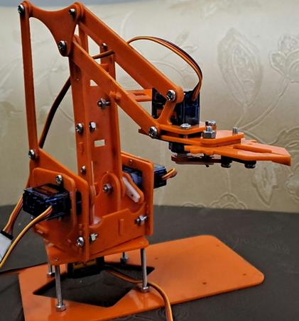
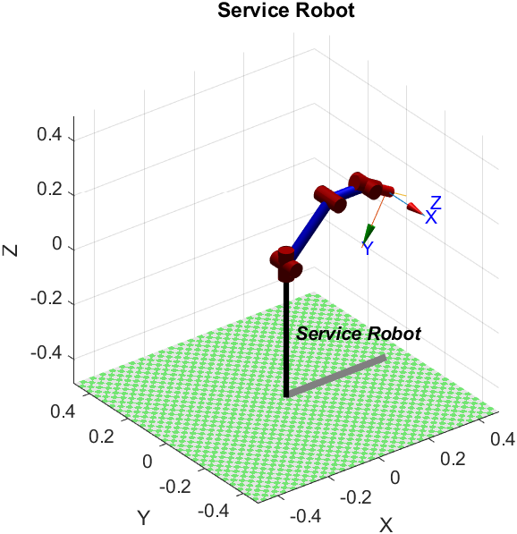
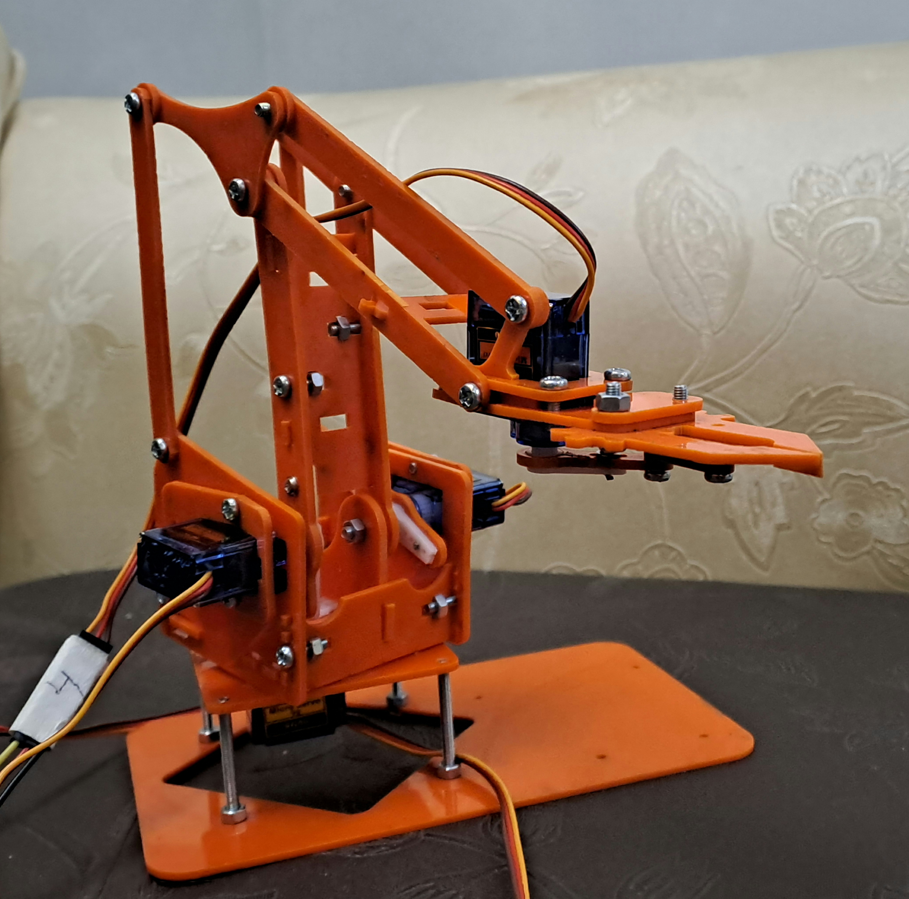
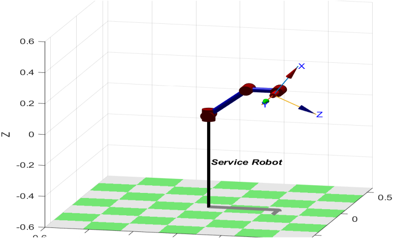
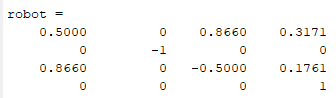
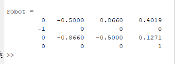

# 4-DOF Robotic Arm

**From mathematical modeling to a working servo-driven manipulator**

Robotics CEP · Mechatronics Engineering · Air University, Islamabad


[**Watch the demonstration**](Video.mp4) · [Project report](4%20DOF%20Robotic%20Arm.pdf) · [MATLAB work](#mathematical-modeling) · [Arduino code](ServoPreset/ServoPreset.ino)

<table>
<tr>
<td width="43%" align="center">
<a href="assets/report_hardware.jpg"></a>
<br><b>Physical implementation</b><br><sub>Original project report photograph</sub>
</td>
<td width="57%" align="center">
<a href="assets/matlab_code_robot.png"></a>
<br><b>Mathematical representation</b><br><sub>Original MATLAB output from the project</sub>
</td>
</tr>
</table>

| **4 revolute joints** | **2 main link lengths** | **4 servo motors** | **Arduino Uno** |
| :---: | :---: | :---: | :---: |
| R-R-R-R configuration | 249 mm / 141 mm | Preset position control | Hardware implementation |

## How this project came together

This was one of the projects that brought robotics to life for me. I wanted to understand how the mathematics behind a manipulator translates into actual movement — not just calculate a transformation matrix or make a robot move in a simulation.

As part of our Robotics CEP, we worked on a four-degree-of-freedom robotic arm intended for pick-and-place tasks. We started with the mathematical representation of the mechanism, worked through the Denavit–Hartenberg parameters and MATLAB simulation, and then used an acrylic robotic arm kit with four servos and an Arduino Uno to implement the physical system.

What made the project valuable was the connection between these two sides: the pose calculated in MATLAB and the movement we command on the real hardware. This repository brings together our original report, MATLAB work, photograph, demonstration recording and Arduino sketch.

## 01 / Physical implementation

The hardware is based on an acrylic robotic arm kit. Its orange structural links, pivot joints, servo actuators and gripper are visible in the original project photograph below.

<p align="center">
  <a href="20240505_144617.jpg"></a>
  <br><em>My original hardware project photograph — May 2024 filename.</em>
</p>

| Component | Purpose | Quantity |
| --- | --- | ---: |
| Acrylic robotic arm kit | Mechanical assembly and gripper | 1 |
| Arduino Uno | Generates servo position commands | 1 |
| Servo motors | Actuation of the four controlled channels | 4 |
| Arduino cable | Programming and communication | 1 |

The model treats the manipulator as four revolute joints (R-R-R-R). The physical kit uses linked mechanical components; the servo-to-joint zero offsets, direction and physical limits must be checked before translating mathematical joint coordinates into hardware commands.

### See the robot in action

**[Watch the original robotic arm demonstration →](Video.mp4)**

The video is the original project recording, not an animation or a generated demonstration. GitHub may open the video file or offer a download instead of playing it inside the README.

## 02 / Mathematical modeling

### Denavit–Hartenberg representation

I used the D–H convention to describe the relative position and orientation of the coordinate frames along the arm. The original report specifies two nonzero link lengths and four revolute joint angles.

| Joint | Type | a (m) | α (deg) | d (m) | θ for the example (deg) |
| :---: | :---: | ---: | ---: | ---: | ---: |
| 1 | R | 0 | 90 | 0 | 0 |
| 2 | R | 0.249 | 0 | 0 | 45 |
| 3 | R | 0.141 | 0 | 0 | −45 |
| 4 | R | 0 | 90 | 0 | 60 |

Source: [Robotics CEP report, p. 2](4%20DOF%20Robotic%20Arm.pdf#page=2).

The standard D–H transform for each link is:

```math
A_i=R_z(\theta_i)T_z(d_i)T_x(a_i)R_x(\alpha_i)
```

Multiplying the four transforms gives the pose of frame 4 relative to the base:

```math
{}^0T_4=A_1A_2A_3A_4
```

The position vector is in the fourth column of the homogeneous transformation matrix; the upper-left 3 × 3 block describes the orientation.

### MATLAB Robotics Toolbox

<table>
<tr>
<td width="59%" align="center"><a href="assets/report_matlab_robot.png"></a><br><b>Four-joint model</b><br><sub>Original report, p. 5</sub></td>
<td width="41%" align="center"><a href="assets/report_toolbox_transform.png"></a><br><b>Forward kinematics result</b><br><sub>Original report, p. 6</sub></td>
</tr>
</table>

For the configuration in the report, the calculated transformation is:

```math
{}^0T_4\approx
\begin{bmatrix}
0.5000&0&0.8660&0.3171\\
0&-1&0&0\\
0.8660&0&-0.5000&0.1761\\
0&0&0&1
\end{bmatrix}
```

The calculated end-frame position is **(317.1, 0, 176.1) mm** relative to the modeled base.

### Including the end-frame extension

My separate MATLAB code document includes an additional fifth transformation with a 98 mm offset and a 90° rotation. I treat this as a fixed tool-frame transformation when reproducing that example, rather than describing it as a fifth independently actuated joint.

<table>
<tr>
<td width="57%" align="center"><a href="assets/matlab_code_robot.png"></a><br><b>Extended-frame model</b><br><sub>MATLAB Code PDF, p. 2</sub></td>
<td width="43%" align="center"><a href="assets/matlab_code_transform.png"></a><br><b>Extended-frame transform</b><br><sub>MATLAB Code PDF, p. 2</sub></td>
</tr>
</table>

```math
{}^0T_5={}^0T_4R_z(\pi/2)T_z(0.098)
```

| Calculated position | X (mm) | Y (mm) | Z (mm) |
| --- | ---: | ---: | ---: |
| Frame 4 | 317.1 | 0.0 | 176.1 |
| Extended frame 5 | 401.9 | 0.0 | 127.1 |

These are model coordinates, not measured physical end-effector positions. The two original MATLAB matrices agree with an independent standard-D–H calculation to four decimal places.

[**Explore the kinematics derivation and numerical checks →**](docs/kinematics.md) · [Run the MATLAB reference](matlab/validate_kinematics.m)

## 03 / Arduino control

The original Arduino program uses the Servo library to define four servo objects, attach them to pins 9–12 and issue a preset position command to each one. The commands in the sketch are:

| Servo | Arduino signal pin | Command |
| :---: | :---: | :---: |
| 1 | D9 | 90° |
| 2 | D10 | 45° |
| 3 | D11 | 135° |
| 4 | D12 | 180° |

```cpp
servo1.write(angle1);
servo2.write(angle2);
servo3.write(angle3);
servo4.write(angle4);
```

The commands are issued in `setup()`; the original `loop()` is empty. Serial communication is initialized at 9600 baud for debugging.

The sketch demonstrates preset positions, not a closed-loop Cartesian controller. The mathematical example angles above are not the Arduino command angles, and a calibrated mapping between these two sets of coordinates is needed.

[**Open the original Arduino sketch →**](ServoPreset/ServoPreset.ino) · [Hardware setup and calibration notes](docs/hardware.md)

## 04 / Engineering cost

The original Robotics CEP report documents the following project costs in Pakistani rupees. This is the historical project budget, not current component pricing.

| Item | Cost (PKR) |
| --- | ---: |
| Acrylic robotic arm kit (including 4 servos) | 3,000 |
| Arduino Uno | 1,000 |
| Arduino cable | 70 |
| **Total** | **4,070** |

## 05 / Reproduce the mathematical results

Clone the project or download the repository:

```bash
git clone https://github.com/HassanAliJanjua03/4-DOF-Robotic-Arm.git
cd 4-DOF-Robotic-Arm
```

Open MATLAB in the repository folder and run:

```matlab
run('matlab/validate_kinematics.m')
```

The reference script uses base MATLAB to calculate the two transforms, check their rotation matrices and compare their entries with the original published outputs. It also plots the modeled frame origins. No Robotics Toolbox installation is required for this reference script.

The original MATLAB work is preserved as PDFs. Its manually written transforms use a different arrangement and mix degree-based trigonometric functions with radian-valued angles; the reference implementation uses standard D–H transforms with consistent radians. It is not a verbatim transcription.

The reference matrices were independently checked numerically; the new script has not been executed in MATLAB. See the [reproduction notes](docs/kinematics.md) for the distinction between the report, original code document and reference implementation.

## What I took from this project

Working through the robot's mathematical model helped me understand that getting a manipulator to move is only one part of robotics. Knowing where the tool is supposed to be, assigning its coordinate frames correctly and connecting the model to physical actuator commands are equally important.

If I were extending the project now, I would focus on joint calibration, a measured comparison of the end-effector pose against the model, and trajectory generation for repeatable pick-and-place motion. Those would take the preset demonstration closer to a complete robotic control system.

## Explore the original project

| File / module | What it contains |
| --- | --- |
| [Robotics CEP report (PDF)](4%20DOF%20Robotic%20Arm.pdf) | Objectives, modeling, hardware implementation, costs and group work |
| [MATLAB code document (PDF)](MATLAB%20Code.pdf) | Original code and extended-frame results |
| [Arduino ServoPreset](ServoPreset/ServoPreset.ino) | Original four-servo position sketch |
| [Original photograph](20240505_144617.jpg) | Full project image |
| [Original demonstration](Video.mp4) | Hardware project recording |
| [Kinematics reference](matlab/validate_kinematics.m) | Reproducible standard-D–H calculations |
| [Engineering notes](docs/kinematics.md) | Frame definitions, equations and comparison with original results |
| [Hardware notes](docs/hardware.md) | Pin assignments and safe reproduction considerations |
| [Original figure gallery](assets/README.md) | Five figures extracted from the original PDFs |

The original report documents the group project and division of work. All original files remain available. No generated robot render or fabricated experimental result is used in this presentation.

---

**Hassan Ali Janjua** · Mechatronics Engineering · Robotics & Control Systems

[My engineering portfolio](https://github.com/HassanAliJanjua03)
