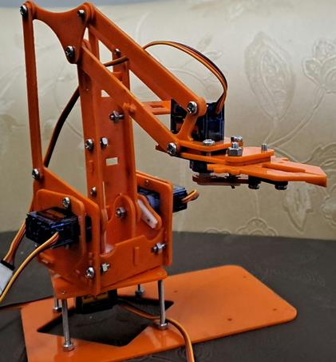

# Hardware and servo control

[Back to project](../README.md) · [Original Arduino sketch](../ServoPreset/ServoPreset.ino)

## Components and signal assignments

The project report (pp. 6–7) identifies an acrylic robotic arm kit, four servo motors and an Arduino Uno. The original sketch includes Servo.h, four Servo objects, attach calls for pins 9–12 and position writes of 90°, 45°, 135° and 180°. It does not publish a measured servo-to-joint calibration.

| Channel | Signal pin | Preset angle |
| --- | --- | --- |
| Servo 1 | D9 | 90° |
| Servo 2 | D10 | 45° |
| Servo 3 | D11 | 135° |
| Servo 4 | D12 | 180° |

These are signal assignments from code, not a complete electrical wiring diagram. The original project does not establish servo model, rated current, supply voltage, or joint limits in the inspected source.

## Before reproducing hardware movement

Confirm the actual servo specifications, supply requirements and mechanical travel. Use an appropriately rated external servo supply with common signal ground, rather than assuming the Arduino 5 V rail can power four servos. Start with one actuator at a time, unloaded where appropriate, and check mechanical limits before applying any preset. In particular, 180° is a commanded value, not evidence that the actual mechanism safely travels to that position. Keep hands away from pinch points and use a means of disconnecting actuator power.

Calibrate the zero angle, direction, travel and linkage geometry of each physical joint before mapping mathematical joint angles to servo commands. Do not equate the Arduino command set to the DH example.

## Original demonstration

[View the original project recording](../Video.mp4). The file is preserved as supplied. No new hardware run, servo calibration, payload test or position-accuracy test has been performed for this repository update.
