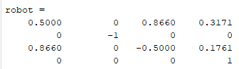
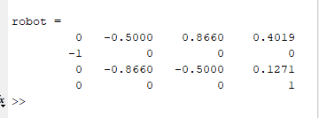

# Kinematics | from joint angles to end-frame pose

[Back to project](../README.md) · [Original report](../4%20DOF%20Robotic%20Arm.pdf) · [Original MATLAB code](../MATLAB%20Code.pdf)

## Source parameters

The Robotics CEP report (p. 2) gives a four-revolute-joint model with link lengths a = [0, 0.249, 0.141, 0] m, twists α = [90, 0, 0, 90] degrees, offsets d = [0, 0, 0, 0] m and example angles θ = [0, 45, -45, 60] degrees. The separate MATLAB Code PDF adds a fifth row: a = 0, α = 0, d = 0.098 m, θ = 90 degrees. In the reference example this last row is a fixed extension, not an additional controlled axis.

## Standard DH transform

```math
A_i=
\begin{bmatrix}
c_i&-s_i c_{\alpha_i}&s_i s_{\alpha_i}&a_i c_i\\
s_i&c_i c_{\alpha_i}&-c_i s_{\alpha_i}&a_i s_i\\
0&s_{\alpha_i}&c_{\alpha_i}&d_i\\
0&0&0&1
\end{bmatrix}
```

Here c_i and s_i are cosine and sine of the joint angle; the other cosine and sine are evaluated at the twist angle. The reference uses radians for all trigonometric functions.

For the four-row model, let L2 = 0.249 m and L3 = 0.141 m. The position of frame 4 is

```math
r=L_2\cos q_2+L_3\cos(q_2+q_3)
```

```math
p_4=
\begin{bmatrix}
r\cos q_1\\
r\sin q_1\\
L_2\sin q_2+L_3\sin(q_2+q_3)
\end{bmatrix}
```

Joint 4 changes orientation but not the origin of frame 4 in this idealized model. The fixed tool extension changes the origin by 0.098 m along the frame-4 z-axis.

## Numerical verification

The standard D–H chain was evaluated independently using the parameters above. The computed positions are:

| Coordinate | Frame 4 (m) | Frame 5 (m) |
| --- | ---: | ---: |
| X | 0.3170695885 | 0.4019400781 |
| Y | 0 | 0 |
| Z | 0.1760695885 | 0.1270695885 |

<table>
<tr><td width="50%" align="center"><br>Original report, p. 6</td><td width="50%" align="center"><br>Original MATLAB Code PDF, p. 2</td></tr>
</table>

All entries of both independently calculated matrices round to the same four-decimal values shown in these original screenshots. This is an analytical reproduction, not a physical accuracy measurement.

## MATLAB implementation

Run [validate_kinematics.m](../matlab/validate_kinematics.m) from the repository root as described in the README. It forms the standard DH chain, verifies the published rounded matrices and checks rotation orthogonality, determinant and extension length.

The original MATLAB PDF uses Link, SerialLink, fkine and plot from Peter Corke's Robotics Toolbox. Its manual matrix construction uses degree-based trigonometric functions on values defined in radians and places terms differently from standard DH. The numerical reference therefore reconstructs the consistent standard-DH calculation rather than copying the manual expressions. The screenshots are consistent with that reference.

## Scope of control

The original project report describes the forward/inverse-kinematics work as part of the team workflow. The available executable Arduino file issues fixed servo commands, and the MATLAB PDF shows forward kinematics. There is no independently verified inverse-kinematics solver or closed-loop Cartesian controller in the published files. The mathematical frame origins do not determine calibrated physical servo angles without joint zero offsets, signs and linkage constraints.

The reference MATLAB script has not been run in MATLAB in this update. The matrices were calculated separately and compared with both original screenshots.
